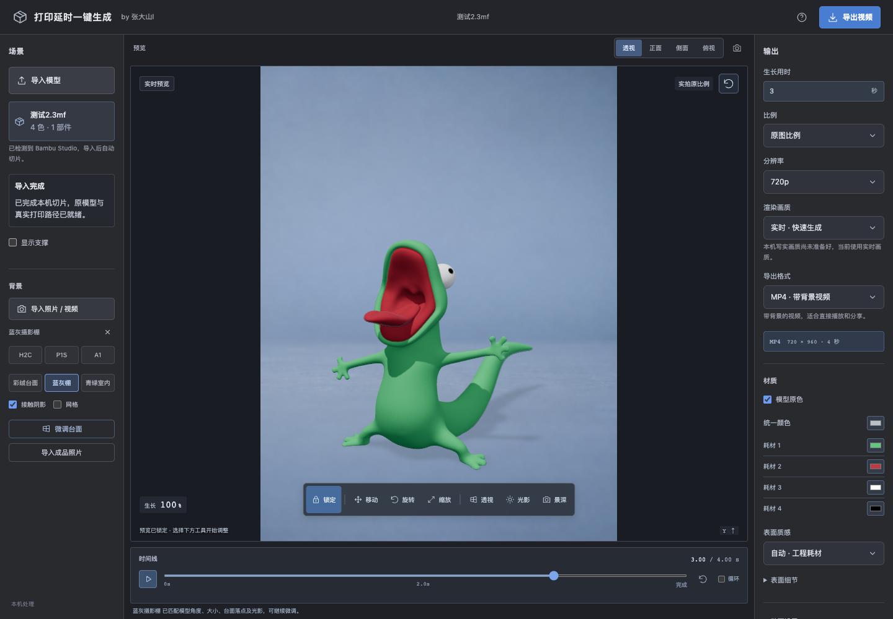

# 打印延时一键生成

把自己的 3MF / STL 模型做成从底部逐层生长的视频，可叠加照片或固定机位背景视频。模型和素材在本机处理，无需账号或授权码。

作者：**张大山l**。这是模型模拟动画工具；输出不是实际打印过程的拍摄录像，也不控制打印机。



[查看 4 秒案例演示](docs/media/demo-model.mp4)：实时画质，3 秒生长 + 1 秒停留，演示隐藏支撑。

## 能做什么

- 导入包含原模型网格的**单盘 3MF** 或 **STL**，调用本机切片器计算实际打印路径。
- 显示真实切片的墙线、填充和支撑，保留支持格式中的多色信息；完成时显示完整原模型。
- 使用 H2C、P1S、A1 三套打印机照片背景与三套摄影背景，也可导入自己的照片或视频。
- 调整模型位置、透视、光影、材质、景深、画面比例和生长时间。
- 导出带背景 MP4、透明 MOV（ProRes 4444）或透明 PNG 图片序列 ZIP。
- 默认实时画质；安装 Blender 后可选 Cycles 写实预览与导出。

## 先运行起来

当前已验证 **macOS Apple Silicon**；Windows / Linux 的完整制作流程尚未验证。这是源码运行版，下载内容不包含 Node.js、Python、切片器、FFmpeg 或 Blender。

| 依赖 | 用途 |
| --- | --- |
| Node.js 24 LTS（最低 22） | 运行本机服务与工作台 |
| Python 3 | 准备模型工程，调用切片流程 |
| Bambu Studio、OrcaSlicer 或 Flash Studio | 至少安装一种兼容本机切片器 |
| FFmpeg | MP4 / MOV 编码；不安装时可导出 PNG 序列 |
| Blender 4.5 LTS，可选 | Cycles 写实画质 |
| OpenCV + NumPy，可选 | 照片竖线候选检测；不安装时仍能手动标记 |

在解压后的项目文件夹打开终端：

```sh
npm ci
npm run doctor
npm start
```

打开终端显示的本机地址，默认 `http://127.0.0.1:4317`。macOS 完成首次安装后也可双击 `start.command`。使用和导出期间保持页面与终端打开；在终端按 `Ctrl+C`，或关闭启动终端即可结束服务。

第一次制作：**导入模型 → 等待本机切片 → 选择背景 → 调整摆放 → 导出**。可导入用户指定的多色案例 [测试2.3mf](examples/测试2.3mf)，使用实时画质和短视频检查流程；模型来源与独立许可见 [案例说明](examples/README.md)。

详细说明见 [快速开始](docs/QUICK_START.md)，运行环境与测试见 [开发说明](docs/DEVELOPMENT.md)。

## 使用范围与当前限制

- 输入需要原模型网格。不接受独立 G-code、只有路径的已切片文件或多盘工程。
- 镜头固定，动画从下往上生长；尚无移动机位跟踪或自动前景遮挡。
- 自动检测切片器的优先顺序为 Bambu Studio → OrcaSlicer → Flash Studio。已实切验证 Bambu Studio 02.07.01.57 和 Flash Studio 2.4.2；OrcaSlicer 尚未在本机完整实切验证。
- 原色取决于 3MF 中可读取的涂色、耗材与对象信息。STL 本身没有多色资料；缺失的内部颜色无法从外观推断。
- 完整历史支撑和背景视频使用实时画质。写实画质需要静态照片；显示完整历史支撑时需先关闭支撑。
- 写实渲染较慢，仍可能有 CG 质感；单张照片的相机与光照只是可调整的估计。细密层纹和支撑仍可能产生摩尔纹。
- 大模型、高分辨率或长视频会受显卡、内存与任务预算限制。程序不会通过悄悄减面、删路径或丢帧来绕过限制。

模型、背景和设置保存在当前浏览器的本机缓存中；清除浏览器数据会影响恢复。导出成品另存到项目 `exports/`，请自行备份。首次 `npm ci` 需要联网获取依赖，制作流程不要求上传模型或照片。

## 开源与素材

本项目原创代码采用 [MIT 许可证](LICENSE)，欢迎使用、修改和贡献。保留作者署名、分享你的成片，有助于更多人发现这个工具。

第三方 Bambu 参数资料保留自己的 AGPL-3.0 许可；示例模型保留原许可，不由代码 MIT 许可覆盖。依赖、外部软件和背景素材也按各自条款处理，详见 [第三方声明](THIRD_PARTY_NOTICES.md)。本项目不代表相关打印机品牌或切片器厂商。

此公开版保留运行所需源码、测试、六套背景、一个指定案例及演示和最小切片配置，不包含历史研究、其他私人素材、历史导出作品、运行时二进制或个人环境修复脚本。发布准备见 [发布清单](docs/RELEASE.md)。
