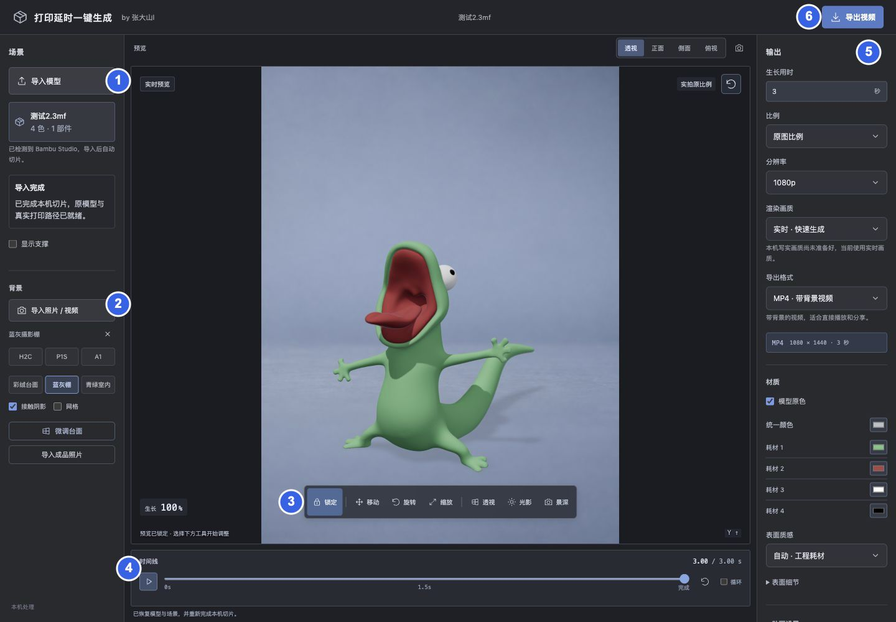
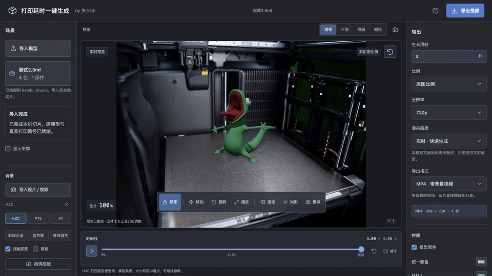
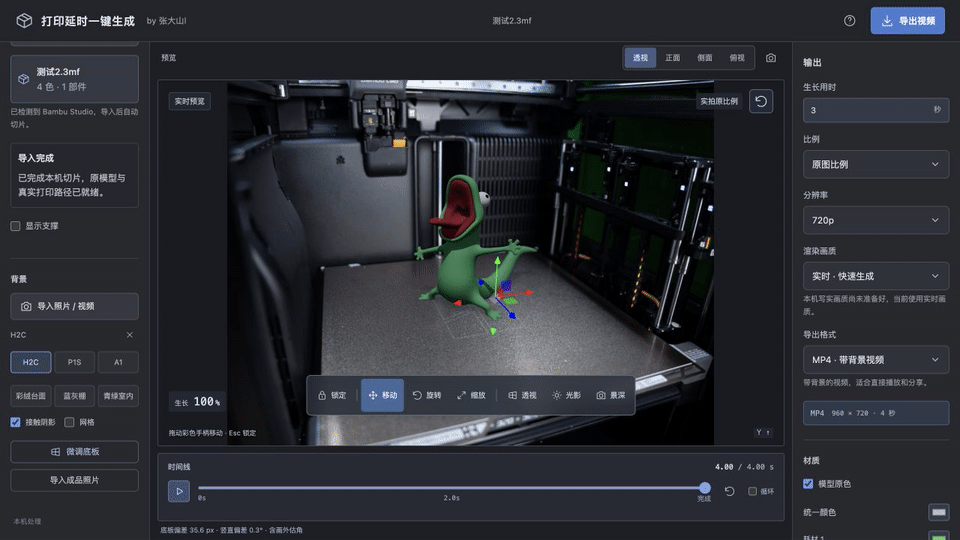
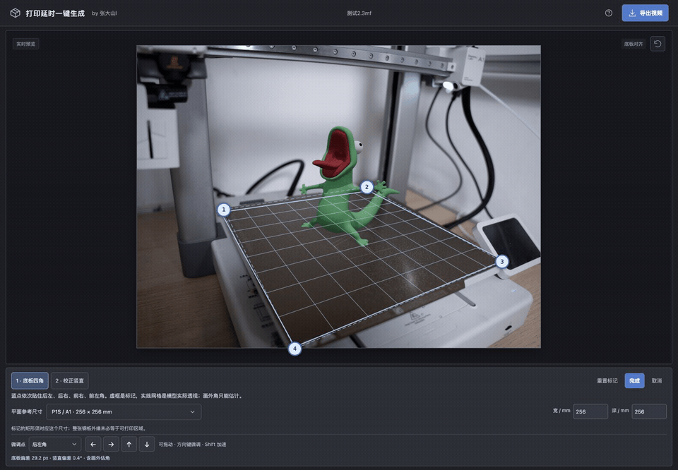
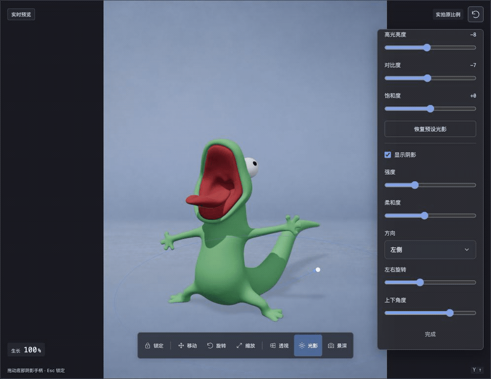
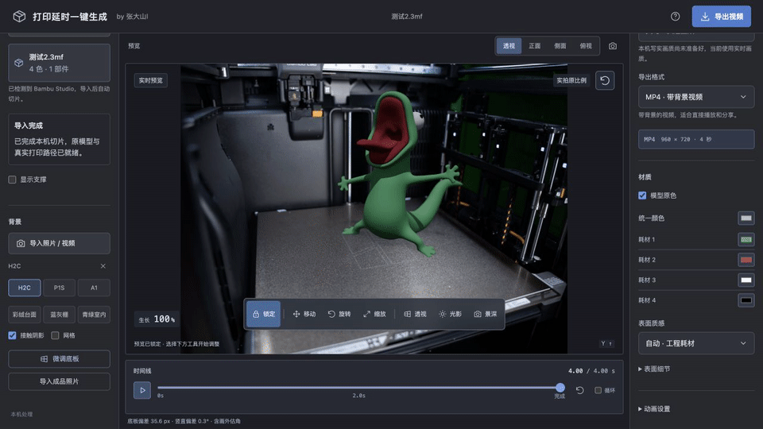
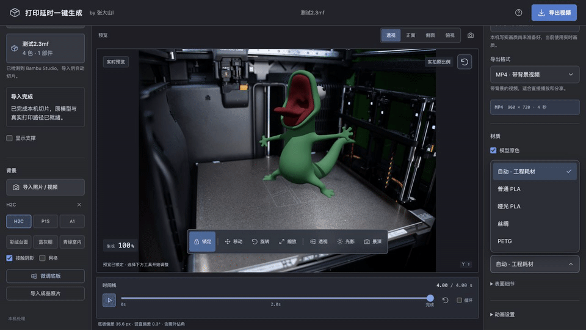

# 打印延时一键生成

导入 3MF / STL 模型，生成从底部逐层生长的视频。支持多色模型、真实切片路径、照片或固定机位视频背景，以及模型摆放、透视、光影和材质调整。

## 效果展示


[查看清晰 MP4](docs/media/demo-model.mp4) · [下载案例模型](examples/测试2.3mf)

示例使用蓝灰摄影棚背景：3 秒生长、1 秒停留、720p、24 fps。

## 界面与常用按钮



| 编号 | 按钮区域 | 操作 |
| --- | --- | --- |
| 1 | 导入模型 | 选择单盘 3MF / STL，等待切片完成；“显示支撑”控制画面中的支撑。 |
| 2 | 背景 | 在“选择背景预设”中选择 H2C、P1S、A1 或摄影背景；自己的照片用“自定义导入图片背景”。 |
| 3 | 模型工具栏 | 移动、旋转、缩放与透视；通过“阴影调节”“色彩匹配”“镜头虚化”分别调整投影、模型色彩和虚化。 |
| 4 | 时间线 | 播放、从头播放、拖动进度查看各阶段，勾选循环。 |
| 5 | 输出与材质 | 设置生长时间、比例、分辨率、格式、模型原色与表面质感。 |
| 6 | 导出视频 | 等待生成完成，点击下载视频或图片序列。 |

[完整按钮图解与操作动图](docs/UI_GUIDE.md)

## 支撑显示



案例切片完成后，勾选左侧“显示支撑”查看树状支撑，取消勾选查看模型本身。拖动时间线可检查支撑与模型在不同层高的状态。

## 模型移动与缩放



点击“移动”（W）拖动彩色手柄调整位置；点击“缩放”（R）拖动手柄同比例改变大小。调整后点击“锁定”或按 Esc。

## 底板透视对齐



1. 选择 H2C 背景，点击“调整底板，矫正透视”。
2. 选择“H2C · 330 × 320 mm”，把四个蓝点依次贴到对应尺寸区域的后左、后右、前右、前左角；用“微调点”和方向按钮精调。
3. 切到“校正竖直”，把绿色参考线贴住照片中的立柱，确认参考线后点击“完成”。

如需用成品照片对照模型，可点击“导入成品照片辅助对齐（可选）”；没有成品照片也可完成上述透视调整。

详细步骤与大图见 [底板透视对齐教程](docs/UI_GUIDE.md)。

## 阴影、色彩与镜头虚化



1. 点击工具栏“阴影调节”，根据背景调整阴影方向、强度与柔和度。
2. 点击独立的“色彩匹配”，调节模型亮度、色温、暗部、高光、对比度和饱和度。原“颜色与光线”设置已移到这里。
3. 需要虚化时点击“镜头虚化”，调整虚化强度和焦点位置；“恢复预设光影”可重新应用当前背景的参数。

上方动图保留旧版布局参考；beta.2 的操作入口以这三个独立工具栏按钮为准，新增面板拆分仍待本轮回归验证。

## 模型配色



右侧“材质”中的“模型原色”保留工程涂色分区，修改“耗材 N 颜色”可为对应区域换色。“统一颜色”让全模型使用同一颜色，重新勾选“模型原色”可切回分区配色。

## 材质选择



在“表面质感”选择自动工程耗材、普通 PLA、哑光 PLA、丝绸或 PETG，比较表面光泽；展开“表面细节”调整细节强度。

更多操作：[背景切换 GIF](docs/media/ui-backgrounds.gif) · [工具与时间线 GIF](docs/media/ui-tools-preview.gif) · [设置与导出 GIF](docs/media/ui-export.gif)

## 快速开始

本轮更新版本为 **1.2.0-beta.2**，待发行：[发行后固定版本下载](https://github.com/dashan914/growth-timelapse-studio/releases/tag/v1.2.0-beta.2) · [发行后安装指南](https://github.com/dashan914/growth-timelapse-studio/blob/v1.2.0-beta.2/INSTALL_AGENT.md)。上一版 **1.2.0-beta.1** 已公开预发布；维护者完成 beta.2 发行并验证下载资产后，再使用本轮固定安装链接。

安装后可直接导入、编辑和预览模型；免费用户可以导出带动态品牌水印的 MP4。无水印视频、预览图片、透明 MOV 和 PNG 序列需要解锁。点击“导出解锁”，可选择一年授权 ¥19.90（365 天）或永久授权 ¥39.90，在软件内扫码支付后自动激活；也可在 [山地造物购买页面](https://ai3dclass.cn/software/checkout) 购买并复制兑换码。

购买授权绑定一台设备，首次激活需联网，成功后有效期内可离线使用；换机前先解除旧设备绑定并保留兑换码。山地造物学员仍从原 [星光兑换页面](https://ai3dclass.cn/points) 兑换，星光和学员码设备规则保持不变；已有兑换码继续使用原激活流程。

扫码时仍保留“山地造物学员”入口。未付款可返回套餐选择，改选一年（YEAR）或永久（LIFETIME）；返回不会取消原订单，原二维码在有效期内仍可付款，请只支付最终选择的一笔。原订单凭证会在本机存档；付款结果不确定时，先查询原订单。

beta.2 调整免费水印为更小、更淡的品牌标识，在画面中部缓慢双轴移动；预览和实际导出采用同一水印样式。同时将工具栏拆为“阴影调节”“色彩匹配”“镜头虚化”，新增面板交互待回归验证。具体参数和验证状态见 [软件购买与水印说明](docs/SOFTWARE_PURCHASE.md)。

支持本机终端操作的 Agent 可按 [安装指南](INSTALL_AGENT.md) 自动检查环境、安装缺失依赖并启动。

Windows x64 下载后的必做检查、特殊路径配置及可选写实模式见 [Windows 配置与验收](docs/WINDOWS_SETUP.md)。当前版本包含 Windows 兼容 PR 的已登记应用发现、控制台输出捕获与跨平台 PNG 打包，并通过 [14 个拓竹机型 × 4 种喷嘴的 56 项切片矩阵](docs/BAMBU_PRINTER_COMPATIBILITY.md)。

| 依赖 | 用途 |
| --- | --- |
| Node.js 24 LTS（最低 22） | 启动工作台 |
| Python 3 | 准备切片工程 |
| Bambu Studio / OrcaSlicer / Flash Studio | 至少安装一种，用于本机切片 |
| FFmpeg | MP4 / MOV 编码 |
| Blender、OpenCV + NumPy（可选） | 写实画质、照片立柱检测 |

在项目目录执行：

```sh
npm ci
npm run doctor
npm start
```

打开终端显示的地址，默认 `http://127.0.0.1:4317`。macOS 完成安装后也可双击 `start.command`。

安装器安装后会生成独立启动入口，作品和激活记录存放在用户数据目录，升级保留这些文件；位置见 [Agent 安装指南](INSTALL_AGENT.md)。

制作流程：**导入模型 → 选择背景 → 调整摆放和光影 → 预览 → 导出**。

安装配置与常见问题见 [快速开始](docs/QUICK_START.md)，开发与测试见 [开发说明](docs/DEVELOPMENT.md)。

## 输出格式

| 格式 | 用途 | 授权 |
| --- | --- | --- |
| MP4 | 带背景和投影的完整视频 | 免费动态水印；解锁后无水印 |
| MOV · ProRes 4444 | 带透明通道的视频，供剪辑合成 | 需要解锁 |
| PNG 序列 ZIP | 透明逐帧图片，供后期合成 | 需要解锁 |

生长用时与完成停留共同决定总时长。可选择原图比例、横屏、竖屏或裁剪，输出 720p、1080p 或 4K。导出文件保存在 `exports/`，也可从完成窗口下载。

上一版已记录完整自动测试 869 项：851 通过、18 跳过、0 失败；beta.2 的新增交互验收结果待补录。56 项拓竹矩阵验证本机真实切片与路径解析，未逐台实体打印；完整范围与历史记录见 [验证记录](docs/VERIFICATION.md)。

## 许可证

代码采用 [MIT 许可证](LICENSE)。依赖、配置与素材来源见 [第三方记录](THIRD_PARTY_NOTICES.md)。
