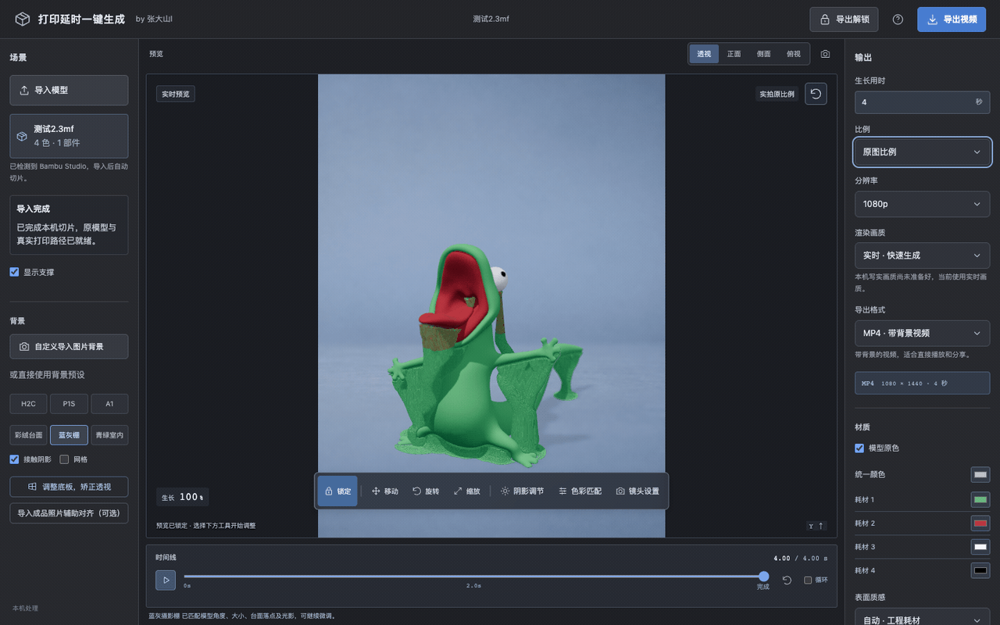
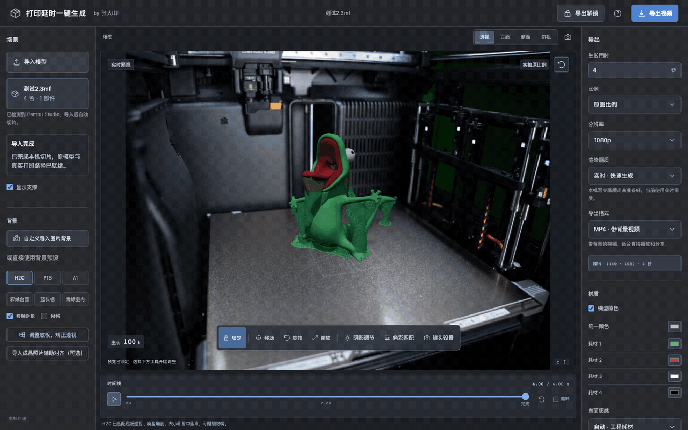
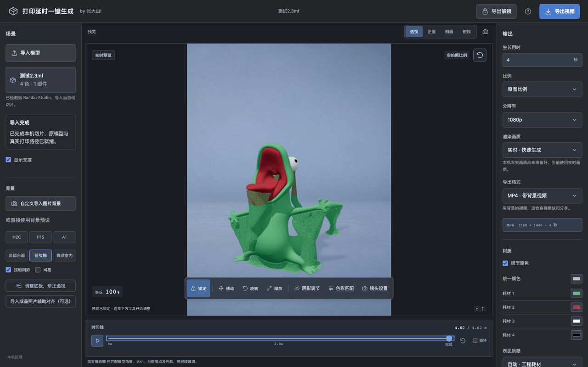
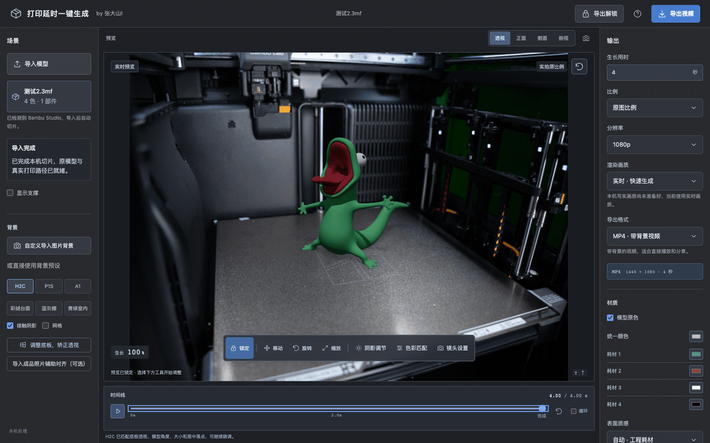
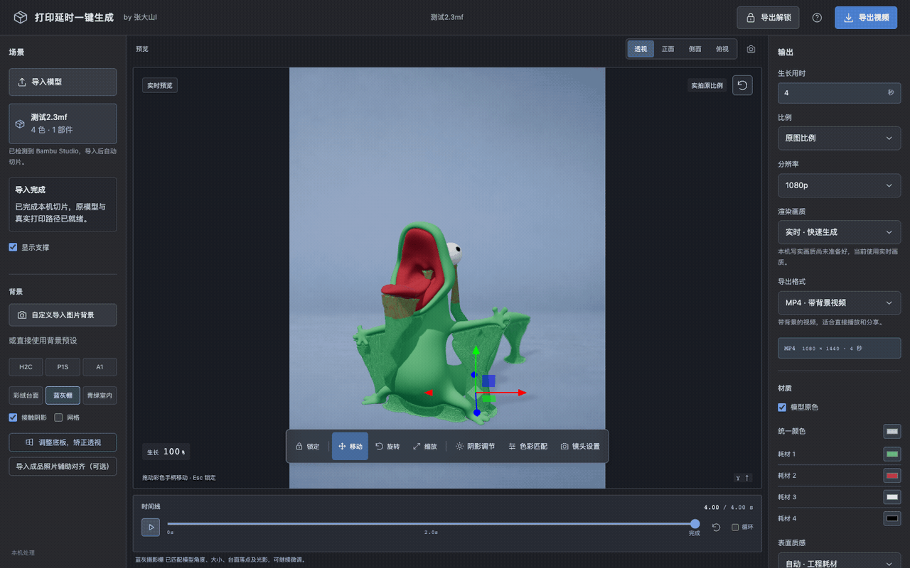
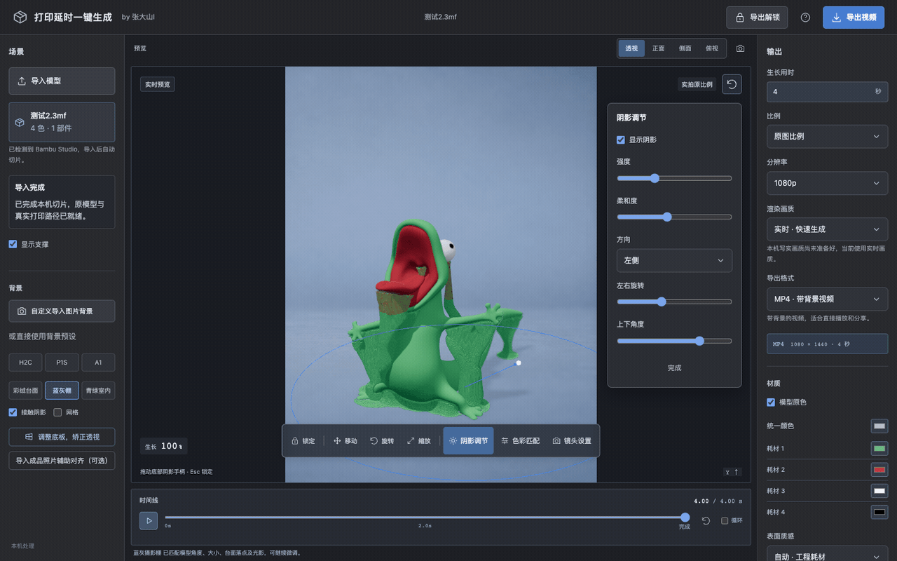
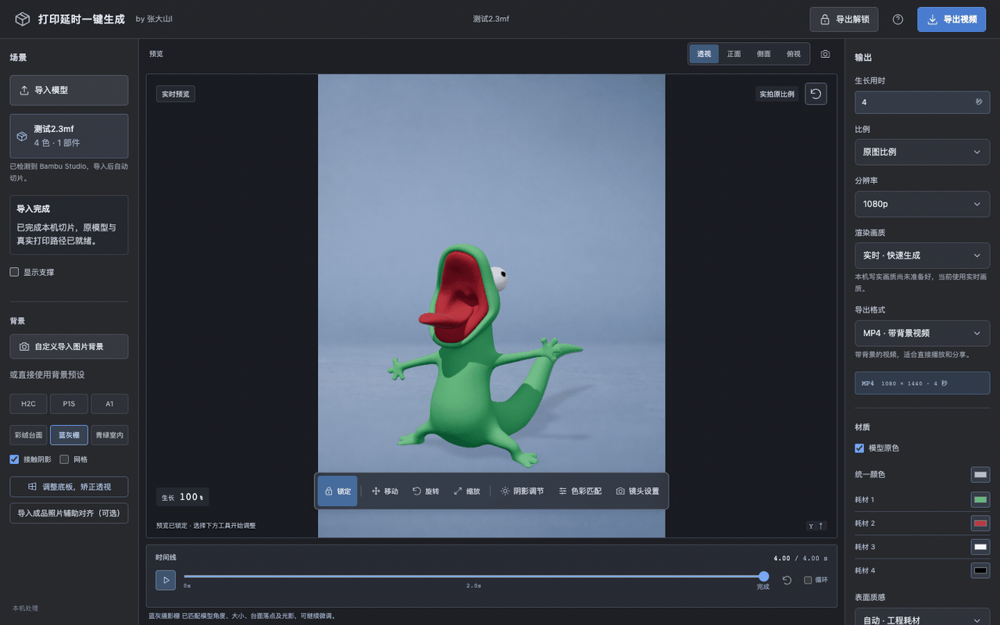

# 打印延时一键生成

把单盘 3MF / STL 模型变成从底部逐层生长的视频。导入模型后，工具调用本机切片器生成真实打印路径，再结合背景、模型摆放、光影和材质完成画面。



工作台展示模型、背景、时间线与当前工具栏。

以下 GIF 在 beta.5 中录制，展示沿用的基础操作；beta.6 的运镜、音效和材质调整见下文。

[查看清晰 MP4](docs/media/demo-model.mp4) · [下载案例模型](examples/测试2.3mf) · [安装指南](https://github.com/dashan914/growth-timelapse-studio/blob/main/INSTALL_AGENT.md)

## 可以做什么

- **逐层生长动画**：按实际切片路径展示模型生长，可调整生长时间、完成停留和帧率。
- **多色模型与材质**：保留 3MF 的涂色分区，修改耗材颜色，比较 PLA、哑光、丝绸和 PETG 等表面质感。
- **打印机或摄影背景**：选择内置背景，或导入自己的照片、固定机位视频；照片可用底板四角和竖直参考线校正透视。
- **摆放与画面调整**：移动、旋转、缩放模型，分别调整阴影、色彩、镜头焦段和虚化。
- **镜头推进与音效**：调整匀速推进的幅度和用时，使用默认音效或导入自己的音效，预览与成片同步播放。
- **时间线预览**：播放、循环、拖动进度，检查模型和支撑在不同层高的状态。
- **多种输出**：生成 MP4、透明 MOV 或 PNG 序列，适合直接分享或后期合成。

制作流程：**导入模型 → 选择背景 → 调整摆放和画面 → 预览 → 导出**。

## 背景与构图



在“或直接使用背景预设”中选择场景，自动应用对应构图；自己的照片使用“自定义导入图片背景”。需要对齐照片时，点击“调整底板，矫正透视”。

## 显示与隐藏支撑



1. 导入在切片工程中确实包含支撑的单盘 3MF，等待本机切片完成。
2. 勾选左侧“显示支撑”查看支撑，取消勾选只看模型；拖动时间线比较不同层高。
3. 如果开关不可用或提示“此切片未包含支撑”，先在切片软件中启用支撑并确认切片预览包含支撑，保存含原模型的 3MF 工程后重新导入。这个开关只控制已有真实支撑的显示。

## 底板矫正透视



动图使用 H2C 背景与 330 × 320 mm 参考尺寸。自己的照片仍须按实际标记矩形确认尺寸和角点。

1. 选择照片背景，点击“调整底板，矫正透视”；在“平面参考尺寸”选择对应尺寸或填写实际宽、深。H2C 示例为 330 × 320 mm，P1S / A1 示例为 256 × 256 mm；所标矩形须对应这个尺寸，钢板外缘未必等于打印区域。
2. 在“1 · 底板四角”依次把蓝点贴到 **后左 → 后右 → 前右 → 前左**；使用“微调点”和箭头按钮精调，或选中画面端点后按方向键。
3. 切到“2 · 校正竖直”，把绿线两端贴住照片中真实竖直的立柱或导轨，勾选“使用已贴住立柱的参考线”；绿线应沿照片中的立柱方向。
4. 检查实线网格方向与模型底部落点，点击“完成”。“取消”返回调整前的场景。

## 模型移动与缩放



点击“移动”（W）、“旋转”（E）或“缩放”（R），拖动手柄调整模型；点击“锁定”或按 Esc 结束。阴影、色彩与镜头分别在“阴影调节”“色彩匹配”“镜头设置”中调整。

## 色彩与镜头设置



“色彩匹配”调整模型亮度、色温、对比度和饱和度；“镜头设置”调整焦段、虚化强度与焦点位置。多色工程还可以修改耗材分区颜色，或使用统一颜色。

## 更改模型颜色



1. 多色 3MF 在右侧“材质”勾选“模型原色”，保留工程的耗材分区；点击“耗材 N”色块，修改该耗材对应区域的颜色。
2. 点击“统一颜色”色块选择颜色，程序会取消“模型原色”，整个模型使用一种颜色。
3. 再勾选“模型原色”切回分区显示，保留此前的耗材颜色调整。单色模型可直接使用“统一颜色”。

[完整操作指南](docs/UI_GUIDE.md)

## 快速安装

当前固定版本为 **v1.2.0-beta.7**，官方安装文件为 `growth-timelapse-studio-1.2.0-beta.7-runtime.zip`。下载运行包和同版本外部安装清单，核对 SHA256 后安装。

[固定版本下载](https://github.com/dashan914/growth-timelapse-studio/releases/tag/v1.2.0-beta.7) · [直接下载官方运行包](https://github.com/dashan914/growth-timelapse-studio/releases/download/v1.2.0-beta.7/growth-timelapse-studio-1.2.0-beta.7-runtime.zip) · [AI 一键安装](https://github.com/dashan914/growth-timelapse-studio/blob/main/INSTALL_AGENT.md)

可以把安装指南交给能操作本机终端的 Agent，按固定版本检查依赖、核对 SHA256、安装并启动。Windows x64 的依赖与首次检查见 [Windows 配置说明](docs/WINDOWS_SETUP.md)。

复制下面这段给能操作你电脑的 AI：

```text
请帮我安装并启动最新版本的“打印延时一键生成”，按照这个官方指南操作。有旧版时使用原安装目录并保留配置和作品；没有旧版时，Windows 安装前先询问我安装到哪个盘。自动检查环境、安装缺失依赖，完成后打开软件并验证导入和预览：
https://raw.githubusercontent.com/dashan914/growth-timelapse-studio/main/INSTALL_AGENT.md
```

已有安装请使用 [Agent 升级指令](INSTALL_AGENT.md#老用户升级)，安装到原目录即可，无需删除重装。原配置、已有工程和导出作品继续保留。当前没有软件内自动更新。

手动启动需准备 Node.js 24 LTS（最低 22）、Python 3，以及 Bambu Studio、OrcaSlicer 或 Flash Studio 中的一种。MP4 / MOV 编码需要 FFmpeg；Blender 和 OpenCV / NumPy 为可选扩展。

在解压目录执行：

```sh
npm ci
npm run doctor
npm start
```

打开终端显示的地址，默认 `http://127.0.0.1:4317`。macOS 也可双击 `start.command`。安装器会生成独立启动入口，并保留用户数据目录中的作品和设置。

更多配置与排查见 [快速开始](docs/QUICK_START.md)。

## 输出格式

| 格式 | 用途 |
| --- | --- |
| MP4 | 包含背景、模型与投影的完整视频 |
| MOV · ProRes 4444 | 带透明通道的视频，用于剪辑合成 |
| PNG 序列 ZIP | 透明逐帧图片，用于后期合成 |

支持原图比例、横屏、竖屏或裁剪，以及 720p、1080p、4K 输出。生长用时与完成停留共同决定总时长，成片可从完成窗口下载。

## 开发与许可

仓库保持 [MIT 开源](LICENSE)，官方运行包用于安装，源码仓库保留开发与测试流程。依赖、配置与素材来源见 [第三方记录](THIRD_PARTY_NOTICES.md)；版本与验证范围见 [验证记录](docs/VERIFICATION.md)。

### 镜头推进与音效

点击画面工具栏中紧挨“镜头设置”的“运镜与音效”，选择“平滑推进”。推进幅度为最终画面放大的百分比（20% 表示最终为 1.2 倍）；推进用时越短，运动越快，默认匀速推进。完成推进后保持最后构图。运镜对整个画面进行中心缩放与裁切，模型和照片背景保持对齐，不改变已保存的相机位置。保存当前画面与视频/PNG 序列导出使用同一推进曲线。

勾选“使用默认音效”，预览与视频导出使用随软件提供的参考原声。也可以导入自己的音效文件，单文件不超过 50 MiB；导入后自动取消默认音效。取消勾选时，有自定义文件就播放该文件，没有文件则静音。移除自定义文件后保持静音；重新勾选默认音效会清除自定义文件。

选中的音效跟随播放、暂停、重新开始和拖动时间线，预览与成片使用同一音效，只播放一次，较长视频的剩余时间保持静音。MP4 和透明 MOV 包含音效；PNG 序列不含声音。MP4 的实景原声可与音效混合。运镜与音效目前使用实时画质；关闭推进、取消默认音效并移除自定义文件后可选择写实画质。默认音效来源见 [音效记录](assets/sounds/SOURCES.md)。

“层纹”和“细节强度”已合并到右侧“材质”区域，可与耗材颜色和表面质感一起调整。
