# 界面操作指南

按“导入模型 → 选择背景 → 调整摆放与光影 → 预览 → 导出”完成一条视频。

本指南适用于本轮待发行的 [v1.2.0-beta.2](https://github.com/dashan914/growth-timelapse-studio/releases/tag/v1.2.0-beta.2)，上一版 1.2.0-beta.1 已公开预发布。安装后可直接导入、编辑、预览并导出动态水印 MP4；保存预览图片、无水印视频、透明 MOV 与 PNG 序列需要解锁。关闭窗口或按 Esc 会继续免费使用，保留当前模型和设置。

点击顶部“导出解锁”或直接开始 MP4 导出，可选择“免费导出 · 带动态水印”，也可购买一年 ¥19.90（365 天）或永久 ¥39.90。选择支付宝或微信，用手机扫描软件内二维码，付款确认后自动激活；购买兑换码可复制保存。已有兑换码仍从输入框激活。

购买授权绑定一台设备，首次激活需联网，成功后有效期内可以离线导出；换机前点击“解除当前设备绑定”，再在新设备输入已保存的兑换码。“山地造物学员”跳转原星光兑换页面，资格、星光和设备规则保持原样。

扫码窗口仍保留“山地造物学员”入口。未付款时可返回套餐选择，改选一年（YEAR）或永久（LIFETIME），也可继续原星光兑换。返回套餐不取消原订单，原二维码在有效期内仍可付款，请只支付最终选择的一笔。原订单凭证会在本机存档；已经付款或结果不确定时，先查询原订单，再决定下一步。

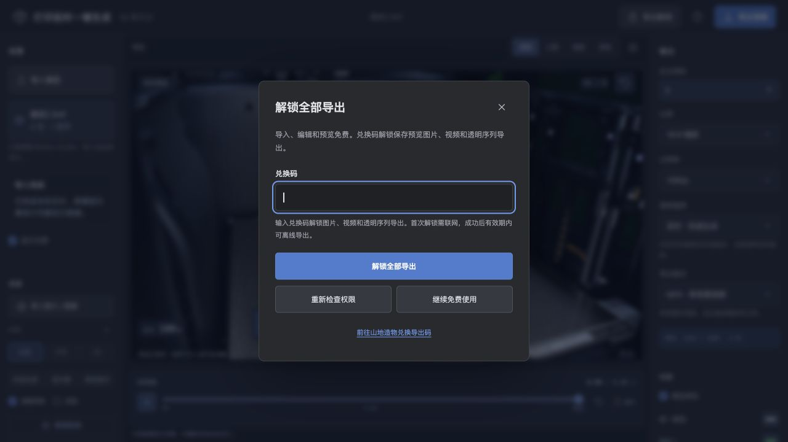

上图保留 1.1.0-beta.1 的兑换码界面参考；1.2.0-beta.1 已增加学员入口、两种购买方案、支付二维码和免费水印导出按钮。1.2.0-beta.2 补充扫码时的学员入口和未付款返回套餐操作。

| 编号 | 操作区 | 用途 |
| --- | --- | --- |
| 1 | 导入模型 | 选择 3MF / STL，查看切片进度与支撑 |
| 2 | 背景 | 导入照片或视频，切换内置场景 |
| 3 | 工具栏 | 移动、旋转、缩放、透视、阴影调节、色彩匹配、镜头虚化 |
| 4 | 时间线 | 播放、从头播放、拖动进度、循环 |
| 5 | 输出 | 设置时长、比例、分辨率、材质与格式 |
| 6 | 导出 | 生成视频并下载 |

## 1. 导入模型与选择背景

点击“导入模型”，选择 [测试2.3mf](../examples/测试2.3mf)，或含原模型网格的单盘 3MF / STL。等待本机切片完成；“显示支撑”控制支撑是否出现在画面中。

在“选择背景预设”中选择 H2C、P1S、A1、彩绒台面、蓝灰棚或青绿室内，应用对应的机位、摆放和光影。切换背景后先检查构图，再继续微调。自己的照片用“自定义导入图片背景”，固定机位视频选择实时画质。

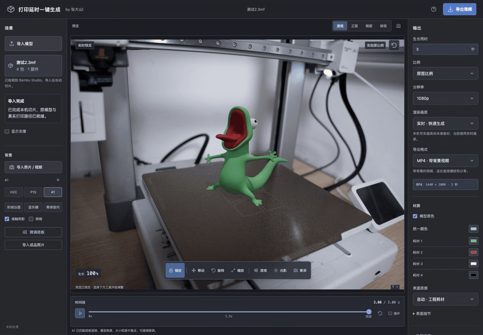

### 显示支撑

1. 等待案例模型切片完成，把时间线拖到 100%，查看完整模型。
2. 勾选左侧“显示支撑”，查看真实切片中的树状支撑；取消勾选，查看模型本身。
3. 把时间线拖到中点（本例为 2 / 4 秒）对比，再点击播放，观察模型与支撑随层高出现。

## 2. 调整摆放与预览

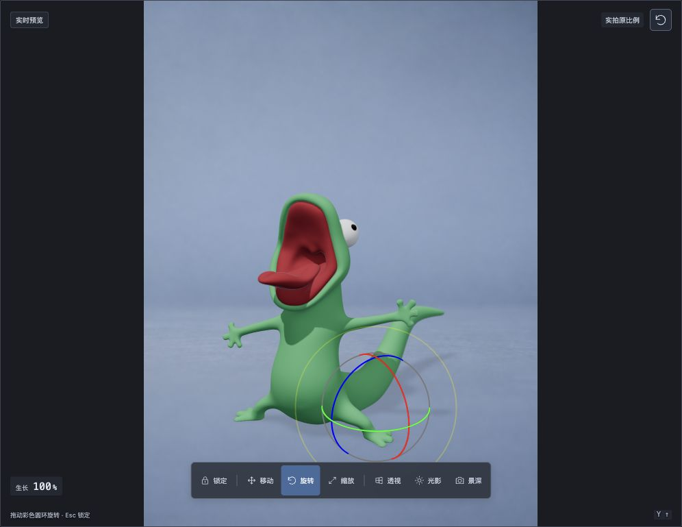

1. 暂停预览，点击“移动”（W），拖动彩色箭头或平面手柄调整位置，检查底部是否落在台面上。
2. 点击“缩放”（R），拖动彩色缩放手柄放大或缩小，模型保持同比例；检查完整模型是否都在画面内。
3. 需要改变朝向时点击“旋转”（E），拖动彩色圆环。点击“锁定”或按 Esc 结束调整，右上角回正图标可恢复背景预设的构图。

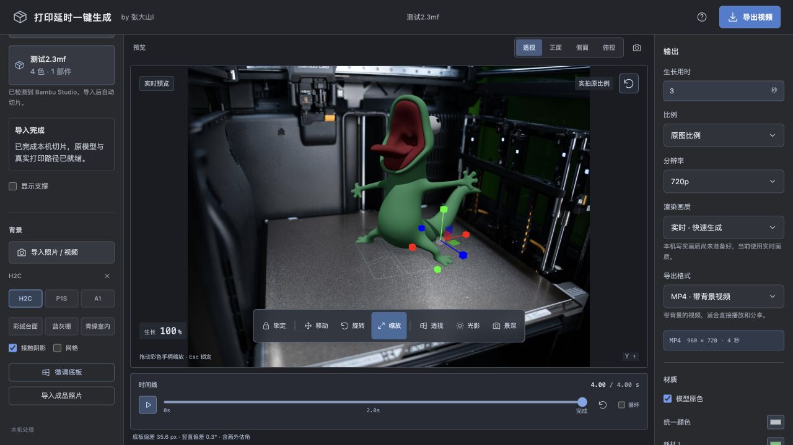

动图展示 H2C 场景中向右移动模型、放大模型，再锁定预览。

底部“透视”可调俯视角、左右视角、镜头焦段与倾斜。顶部“透视 / 正面 / 侧面 / 俯视”用于切换观察方向。

播放按钮预览生长过程；从头播放按钮重新开始，拖动时间线可检查任一阶段，勾选“循环”反复观看。重点看模型位置、底部落点和完整模型是否都在画面内。

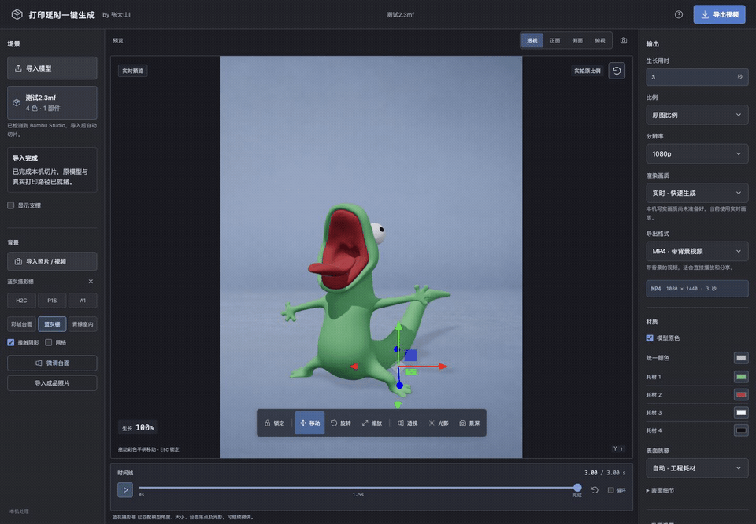

## 3. 对齐底板透视

以 H2C 背景为例，对齐底板四角，再用照片中的立柱校正竖直方向。

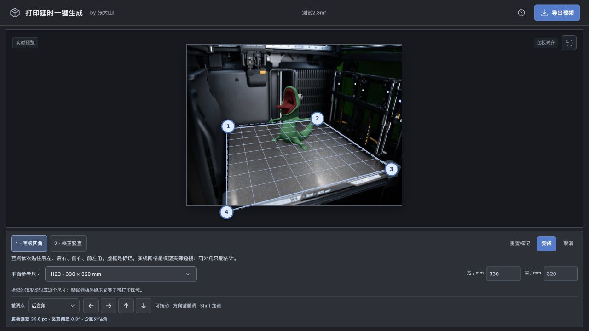

1. 选择 H2C 背景，点击“调整底板，矫正透视”。
2. 在“1 · 底板四角”的“平面参考尺寸”选择“H2C · 330 × 320 mm”，确认宽为 330 mm、深为 320 mm。所标矩形须对应这个实际尺寸，钢板外缘与可打印区域可能不同。
3. 按编号把蓝点贴住四角：1 后左、2 后右、3 前右、4 前左。蓝色虚框是标记，实线网格显示模型相机的实际投影；核对边缘方向与模型底部落点。
4. 用“微调点”选择角点或竖线端点，再点箭头按钮微调；选中画面端点后也可按方向键，按住 Shift 加速。

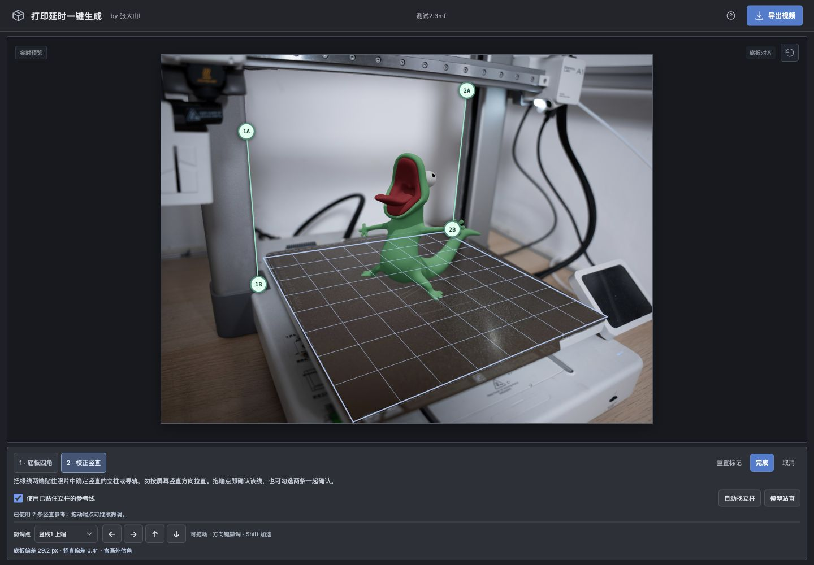

5. 切到“2 · 校正竖直”，把两条绿线的端点贴住照片中的真实竖直立柱。绿线跟随照片里的立柱方向，无需拉成屏幕竖线。“自动找立柱”可提供候选，核对后再调整。
6. 确认后勾选“使用已贴住立柱的参考线”。若模型本身有俯仰或侧倾，可点“模型站直”，保留位置、朝向与大小。
7. 检查网格和模型方向，点击“完成”保存。想回到本次进入时的标记可点“重置标记”；“取消”返回调整前的场景。

如需用成品照片对照模型，可点击“导入成品照片辅助对齐（可选）”。这是辅助步骤，没有成品照片也可完成底板四角和竖直方向调整。

动图展示 H2C 的 330 × 320 mm 参考尺寸、角点微调和竖直校正，再点击“模型站直”并完成。

## 4. 阴影调节、色彩匹配与镜头虚化

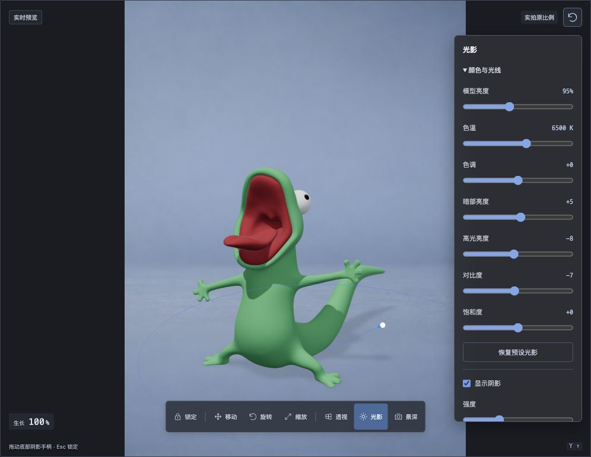

beta.2 将这三类调整分为独立工具栏入口：用“阴影调节”设置投影，用“色彩匹配”调整模型与背景的颜色，用“镜头虚化”设置虚化和焦点。原光影面板中的“颜色与光线”参数已移到“色彩匹配”。

| 入口 | 控件 | 调整时看什么 |
| --- | --- | --- |
| 阴影调节 | 显示阴影、强度、柔和度 | 底部投影的深浅与边缘，确认模型与台面接触自然 |
| 阴影调节 | 方向、左右旋转、上下角度 | 投影朝向和长度，与背景中已有阴影相近 |
| 色彩匹配 | 模型亮度 | 模型整体亮度，与周围物体协调 |
| 色彩匹配 | 色温、色调 | 冷暖与偏色，跟随背景环境 |
| 色彩匹配 | 暗部亮度、高光亮度 | 阴影细节与亮面，保留形体层次 |
| 色彩匹配 | 对比度、饱和度 | 明暗差和颜色浓度，逐项小幅调整 |

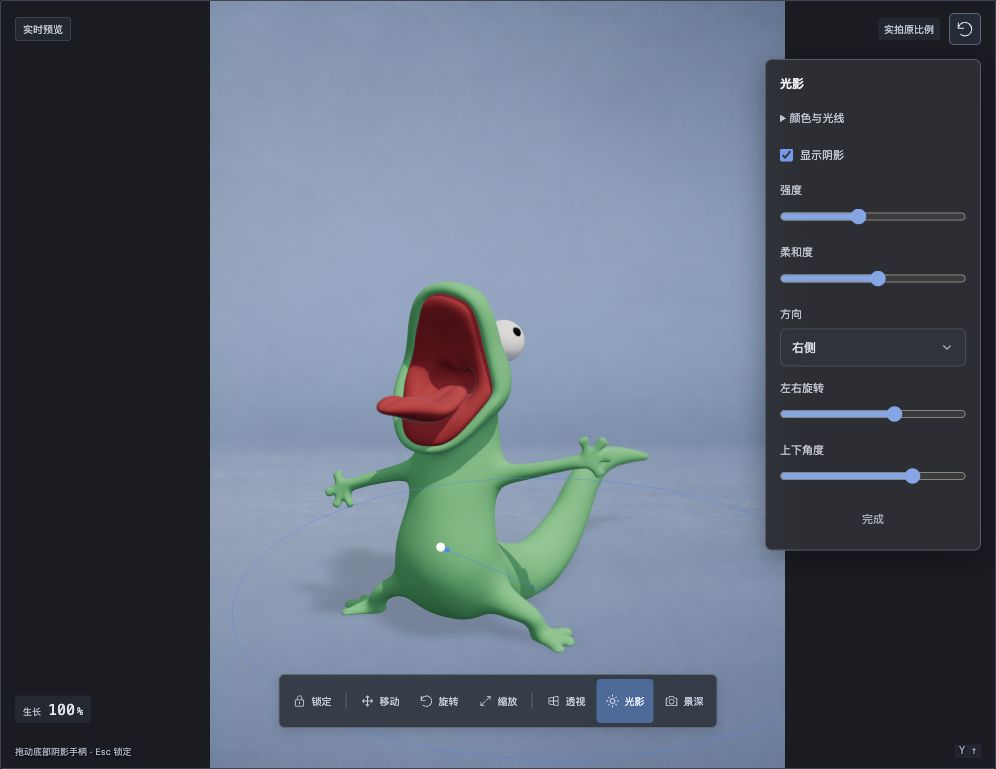

需要调整颜色时直接打开“色彩匹配”；“恢复预设光影”重新应用当前背景的光影与景深。

需要虚化时点击“镜头虚化”，勾选“启用虚化”，调整强度和焦点位置。完成后关闭面板，分别查看完整模型和生长中段。

动图演示模型亮度从 95% 调到 110%，色温从 6500 K 调到 5300 K，再调整阴影强度、柔和度及左右方向，最后恢复预设光影。

本节图片与动图保留旧版布局参考；beta.2 请从三个独立按钮打开对应设置。最新面板拆分的回归结果仍待补录。

## 5. 模型涂色与配色

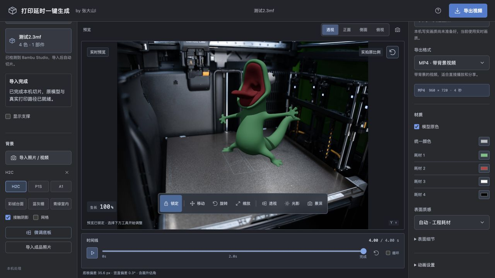

1. 在右侧“材质”勾选“模型原色”，显示 3MF 工程已有的涂色分区与颜色。
2. 点击“耗材 N”的色块，选择新颜色，属于该耗材的区域会一起换色。案例中修改“耗材 1”可改变身体颜色，修改“耗材 2”可改变嘴部颜色。
3. 点击“统一颜色”的色块，选择颜色，全模型改为单色，并自动取消“模型原色”。
4. 重新勾选“模型原色”，回到各耗材分别配色；要恢复案例最初的颜色，将各耗材色块改回原值。

动图依次展示原色、蓝色身体、橙色嘴部、统一紫色，再切回分区配色并恢复案例原色。

## 6. 选择模型材质

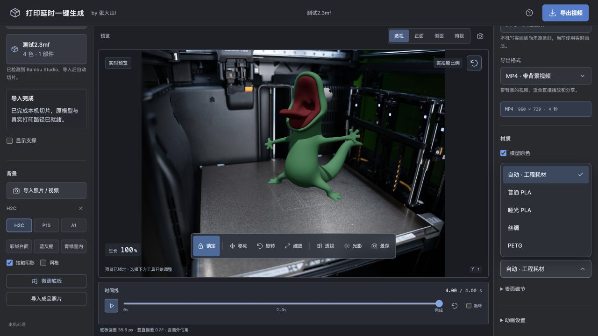

1. 在右侧“材质”点击“表面质感”，选择预设，观察模型表面的高光与粗糙度。
2. 展开“表面细节”，调节“细节强度”；在“动画设置”开启“层纹”，近看层纹效果。
3. 在同一光影下比较效果，选择合适的表面质感；“自动 · 工程耗材”按工程中的耗材类型应用预设。

| 表面质感 | 效果 |
| --- | --- |
| 自动 · 工程耗材 | 按工程耗材选择，缺少类型时使用普通 PLA |
| 普通 PLA | 常规塑料表面 |
| 哑光 PLA | 更柔和的高光与哑光表面 |
| 丝绸 | 更明显的光泽 |
| PETG | 较光滑的塑料质感 |

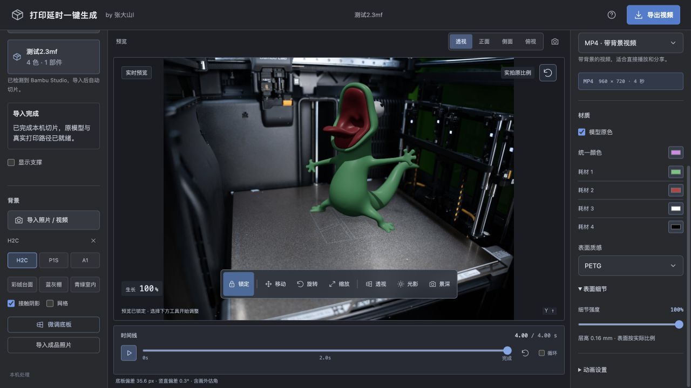

动图展示普通 PLA、哑光 PLA、丝绸、PETG，再比较 0% 与 100% 的细节强度，最后回到自动预设。

## 7. 设置输出并导出

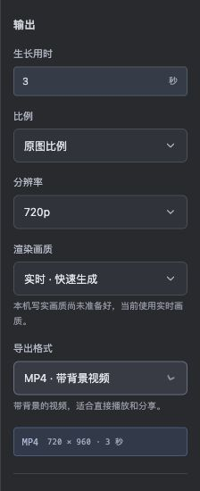

右侧设置“生长用时”、比例、分辨率和渲染画质；展开“动画设置”修改“完成停留 / 秒”和帧率。总时长为生长用时加完成停留。示例使用 3 秒生长、1 秒停留、720p、24 fps。

| 格式 | 输出内容 | 权限 |
| --- | --- | --- |
| MP4 · 带背景视频 | 背景、模型与底面投影 | 免费版写入动态品牌水印；解锁后无水印 |
| MOV · 透明通道视频 | 透明模型视频，用于后期叠加 | 需解锁 |
| PNG · 透明图片序列 | 透明逐帧图片，打包为 ZIP | 需解锁 |

MP4 / MOV 需要 FFmpeg。写实画质需 Blender、静态照片，并关闭完整支撑；首次可选“实时 · 快速生成”。

点击右上角“导出视频”，保持页面与启动终端打开。完成后点击下载，文件也保存在 `exports/`。

免费水印直接写入视频画面，实时与写实 MP4 都会保留完整帧数。beta.2 的品牌水印缩小并变淡，在画面中部缓慢双轴移动；预览与实际导出使用同一水印样式。购买或激活暂时失败时，仍可选择免费 MP4。

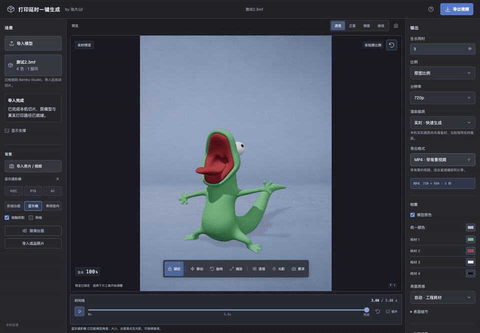

成片效果见 [案例 GIF](media/demo-model.gif) 与 [清晰 MP4](media/demo-model.mp4)。环境安装见 [快速开始](QUICK_START.md)。
